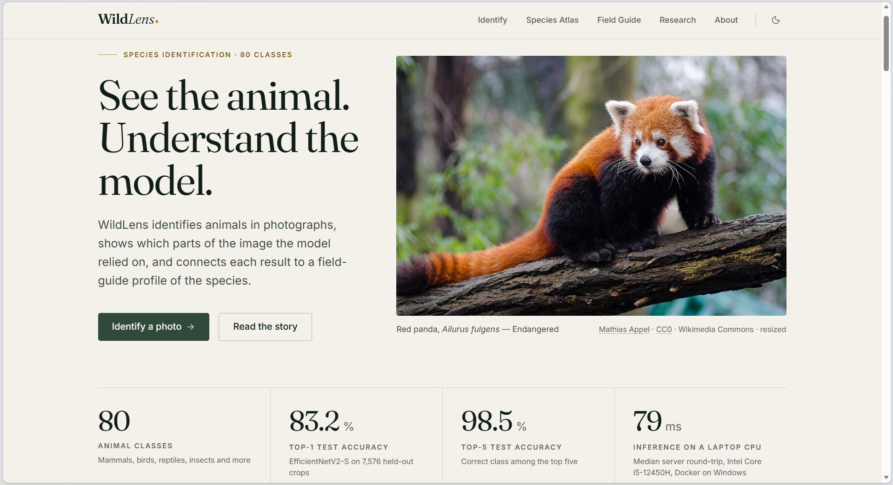
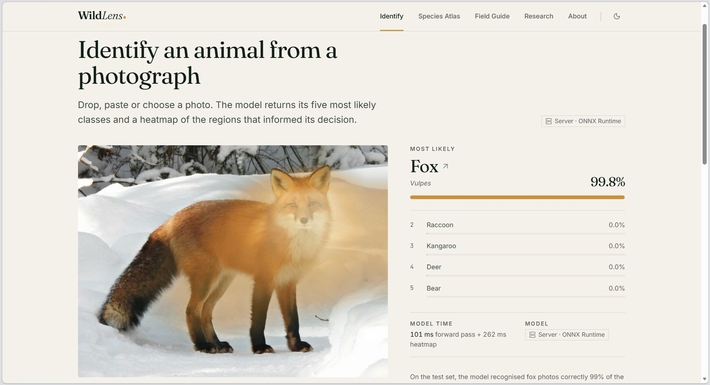
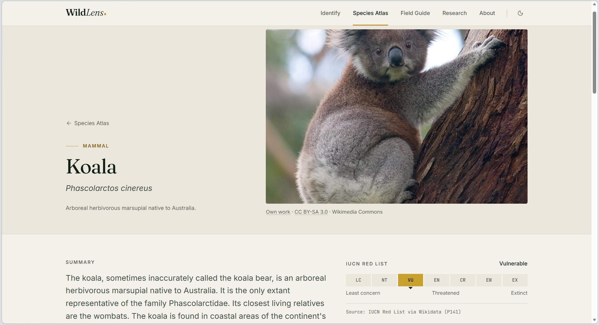
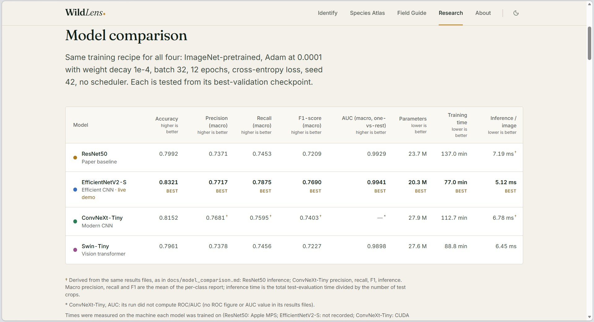
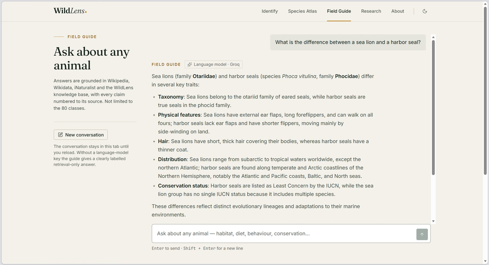

# WildLens: animal species classification with CNN architectures

**WildLens** is a web platform built on a comparative study of four image classifiers trained on the
Animal-80 dataset. Upload a photograph and the study's best model, EfficientNetV2-S, returns its five most likely classes with a class-activation heatmap showing which regions informed the decision. A species atlas covers
all 80 classes with conservation status and GBIF occurrence maps, a Field Guide answers questions
about any animal with cited sources, and a Research section presents the full model comparison. Everything
runs locally on a laptop at no cost; only the chat's live lookups and map tiles need a network.



| Identify | Species profile |
|---|---|
|  |  |
| **Research** | **Field Guide** |
|  |  |

## Features

- **Identify:** drag and drop, paste or choose a photo (or use one of 12 credited samples). Top-5
  classes with confidence, a CAM heatmap with an opacity control, model timing, and a low-confidence
  warning when the photo may not show one of the 80 classes.
- **Two inference modes:** the backend runs the model with ONNX Runtime (default), or the browser
  runs the same model with onnxruntime-web so the photo never leaves the page. Both give identical
  top-5 results on the 20-image parity set.
- **Species Atlas and profiles:** all 80 classes with search and filters, licensed photos with
  attribution, IUCN status, taxonomy, key facts, the model's accuracy on the class and a GBIF map of
  field observations.
- **Field Guide:** chat about any animal, grounded in Wikipedia, Wikidata and iNaturalist with
  numbered citations. Uses a free Groq model when a key is configured; otherwise it gives a clearly
  labelled answer assembled from the retrieved sources.
- **Research:** four-model comparison, training curves, per-class results, confusion matrices and ROC
  figures, deployment notes and an honest limitations section.

## Quick start

You need the model files in `models/` (see [Models](#models)); everything else is in the repository.
Clone it first:

```bash
git clone https://github.com/kartikya2522/animal-species-classification-cnn.git
cd animal-species-classification-cnn
```

### With Docker (recommended for demos)

Requires Docker with Compose v2 (Docker Desktop, or the free Docker CLI with
[Colima](https://github.com/abiosoft/colima) on macOS plus the `docker-compose` plugin). With
Colima, keep the checkout inside your home folder: Colima shares only your home folder with
containers by default, so bind mounts from elsewhere (e.g. `/tmp`) arrive empty.

```bash
make up          # same as: docker compose up --build -d --wait
```

Open **<http://localhost:8080>**. The API and its docs are also on <http://127.0.0.1:8000/docs>.
Stop with `make down` (`docker compose down`); follow logs with `make logs`.

The images contain only code and runtime dependencies (backend ≈ 97 MB compressed, frontend ≈ 32 MB).
The model weights, metrics, figures, species knowledge base and optional photo cache are mounted
read-only from your checkout, and `backend/.env` is read if it exists.

On Windows, use Docker: `make dev` and `make setup` assume a Unix shell and venv layout.

### Without Docker

Requires Python 3.9–3.12 (3.11 recommended) and Node 22 (picked up by `nvm` from `frontend/.nvmrc`
if your default Node is older).

```bash
make setup       # backend/.venv from backend/requirements.txt + npm ci in frontend/
make dev         # backend on :8000 and frontend on :5173; Ctrl-C stops both
```

Open **<http://localhost:5173>**. Run `make help` for all targets.

| Target | What it does |
|---|---|
| `make setup` | Create or refresh `backend/.venv` (prefers `python3.11`; override with `PYTHON=`) and run `npm ci` under Node 22 |
| `make dev` | Start FastAPI (uvicorn `--reload`) and Vite together and print the URL |
| `make up` / `make down` / `make logs` | Docker stack on <http://localhost:8080> |
| `make test` | Backend pytest, Phase-0 model tests (if the ML venv exists), frontend typecheck, lint, format check and Vitest |
| `make e2e` | Playwright end-to-end tests (starts both servers itself) |
| `make check-models` | Verify the local model files against the SHA-256 hashes in `models/registry.json` |
| `make cache-images` | Download the 80 species photos into `data/species_images/` (~32 MB) so pages work offline |

### Models

The trained weights are **not published**: the team demos the platform on its own laptops. The
small model metadata (`registry.json`, `classes.json`, the classifier weights used for heatmaps) is
committed; the ONNX files are gitignored:

| File | Size | Used by |
|---|---|---|
| `models/efficientnetv2_s.onnx` | 81 MB | backend (server mode) |
| `models/efficientnetv2_s.fp16.onnx` | 41 MB | browser mode (99.89% top-1 agreement with FP32) |

To get them, either copy both files from a teammate into `models/`, or export them from the
training checkpoint (`outputs\models\efficientnetv2_s.pth`, also not in git) with
`venv/bin/python scripts/export_onnx.py --fp16` (see `scripts/download_models.sh --help`). Then run:

```bash
make check-models    # [fp32] models/efficientnetv2_s.onnx present, SHA-256 verified. ...
```

Without the files the app still starts; pages, atlas, chat and research work, and identification
reports that the model is not loaded.

### Written chat answers (optional)

Without a key the Field Guide answers from retrieved sources only. For written answers, create a
free Groq key (no card) at <https://console.groq.com/keys>, then:

```bash
cp backend/.env.example backend/.env    # and set WILDLENS_GROQ_API_KEY=...
```

Restart `make dev` or `make up`. `backend/.env.example` documents every setting (`WILDLENS_*`).

## Architecture


With `make dev`, Vite serves the app and proxies `/api` instead of nginx. The heatmap is a class
activation map computed from the network's last convolutional features and classifier weights; for
EfficientNetV2-S's pooling-plus-linear head (dropout is inactive at inference) it is mathematically identical to Grad-CAM, so no gradients are needed at runtime. Details: [`backend/README.md`](backend/README.md) (API, configuration, chat design), [`frontend/README.md`](frontend/README.md) (pages, inference modes, design tokens).

## Project structure

```
├── backend/                  FastAPI service (ONNX Runtime, CAM, species KB, grounded chat) + Dockerfile
├── frontend/                 React + Vite app, nginx config + Dockerfile, Playwright e2e tests
├── models/                   registry.json, classes, efficientnetv2_s_fc.* (committed); *.onnx (not published)
├── data/
│   ├── manifest.csv          master index of the processed crops: filepath, label, split
│   ├── species_kb.json       species knowledge base (built by scripts/build_species_kb.py)
│   ├── species_overrides.json
│   └── LICENSE-DATA.md       data and image licences
├── docs/
│   ├── paper_summary.md, paper_info_table.md, dataset_notes.md, model_comparison.md
│   └── platform/             screenshots/
├── outputs/
│   ├── models/               trained weights, e.g. efficientnetv2_s.pth (gitignored)
│   ├── figures/              confusion matrices, ROC curves, training curves
│   └── results/              per-model metrics (JSON/CSV)
├── scripts/                  ONNX export/evaluation, per-class evaluation (evaluate_per_class.py), KB and photo-cache builders, dev helpers
├── src/                      the ML study: preprocessing, training scripts, shared utils
├── tests/phase0/             ONNX parity tests (PyTorch vs ONNX, preprocessing, CAM)
├── docker-compose.yml, Makefile
└── requirements.txt          ML study dependencies
```

## Tests

| Suite | Command | Count |
|---|---|---|
| Backend (pytest; chat HTTP fully mocked) | `cd backend && .venv/bin/python -m pytest` | 122 |
| Model parity (PyTorch vs ONNX; needs the ML venv and `data/processed`) | `venv/bin/python -m pytest tests/phase0` | 20 (3 bash-script tests skip on Windows) |
| Frontend (typecheck, lint, Prettier, Vitest) | `make test-frontend` | 79 Vitest |
| End-to-end (Playwright: core flows, story pages, server/browser parity) | `make e2e` | 8 |

`make test` runs everything except the end-to-end suite. On Python 3.13 or newer the backend
venv cannot be built (pinned `onnxruntime`/`numpy`); run the backend tests in the Docker image instead.

## Data and licences

The code is under the MIT License ([`LICENSE`](LICENSE)). Species texts come from Wikipedia
(CC BY-SA 4.0), facts from Wikidata (CC0) and iNaturalist, photos from Wikimedia Commons under each
file's own licence (credited wherever shown), and maps from GBIF and OpenStreetMap. See
[`data/LICENSE-DATA.md`](data/LICENSE-DATA.md) for the full list. The Animal-80 images come from
Open Images via Kaggle and are not redistributed here.

## Team

Sameer Kadam · Kartikya Gawali · Yash More · Pratik Bhosale

## Reference Paper

Ukwuoma, C.C., Qin, Z., Yussif, S.B., et al. *"Animal species detection and classification framework based on modified multi-scale attention mechanism and feature pyramid network."* Scientific African, 16 (2022), e01151. [DOI: 10.1016/j.sciaf.2022.e01151](https://doi.org/10.1016/j.sciaf.2022.e01151)

This paper's ResNet-50 backbone and Animal-80 dataset choice motivated the setup of this project, though the paper's own task is two-stage object detection + classification, while this project focuses on pure image classification (see `docs/paper_summary.md` for full details and the scope adjustment).

---

# The study: animal species classification using CNN architectures

A comparative study of four CNN/Transformer architectures — a paper-baseline model, an efficient CNN, a modern CNN, and a vision transformer — trained on the Animal-80 dataset to classify 80 animal species. The WildLens platform above serves the study's best model, EfficientNetV2-S.

## Dataset

**Animal-80** (via [Kaggle](https://www.kaggle.com/antoreepjana/animals-detection-images-dataset)) — 80 animal species classes, sourced from Open Images.

- 29,071 raw annotated images (22,566 train / 6,505 test), each with one or more bounding-box annotations
- Severely imbalanced: largest class (Butterfly) has ~268× more images than the smallest (Seahorse)
- Full dataset description, class distribution, and known data-quality limitations documented in `docs/dataset_notes.md`

*Note: the current public release of this dataset contains fewer images than reported in the source paper (45,132 train / 13,010 test) — this discrepancy is documented and accounted for in the preprocessing notes.*

## Preprocessing Pipeline

1. **Cleaning** — verified all 29,071 images against their annotations (0 skipped)
2. **Crop-to-bounding-box** — each annotated object cropped from its source image
3. **Resize** — all crops standardized to 224×224
4. **Normalization** — mean/std computed directly from the processed training set (not generic ImageNet defaults)
5. **Class-imbalance handling** — classes with fewer than 100 training images augmented (rotation, horizontal flip, zoom, translation, shear) up to 150 images each
6. **Stratified split** — train / validation / test, with the original test set kept untouched as a clean holdout

Full pipeline code: `src/preprocessing/`. Full write-up: `docs/dataset_notes.md`.

## Models

All four models were trained under an identical configuration to ensure a fair comparison: **Adam optimizer, learning rate 0.0001, weight decay 1e-4, batch size 32, 12 epochs, CrossEntropyLoss, seed 42, no learning-rate scheduler**, with ImageNet-pretrained initialization. Each model reports test metrics from its best validation-epoch checkpoint.

| Model | Role | Parameters | Accuracy | Precision (macro) | Recall (macro) | F1-score (macro) | AUC (macro, one-vs-rest) | Training Time |
|---|---|---|---|---|---|---|---|---|
| ResNet50 | Paper Baseline | 23,671,952 | 0.7992 | 0.7371 | 0.7453 | 0.7209 | 0.9929 | 136.97 min |
| **EfficientNetV2-S** | Efficient CNN | 20,279,968 | **0.8321** | **0.7717** | **0.7875** | **0.7690** | **0.9941** | **77.01 min** |
| ConvNeXt-Tiny | Modern CNN | 27,881,648 | 0.8152 | 0.7681 | 0.7595 | 0.7403 | — | 112.74 min |
| Swin-Tiny | Advanced (Transformer) | 27,580,874 | 0.7961 | 0.7378 | 0.7456 | 0.7227 | 0.9898 | 88.84 min |

ConvNeXt-Tiny's AUC is shown as "—" because its training run did not compute it.

**EfficientNetV2-S was the best-performing and most computationally efficient model overall** — highest accuracy, F1, and AUC, with the fewest parameters and fastest training/inference time. Full analysis, per-class breakdowns, and discussion in `docs/model_comparison.md`.

## Study repository structure

The platform files are listed in [Project structure](#project-structure) above. The study itself lives in:

```
├── src/
│   ├── preprocessing/    crop, resize, normalise, augment and split pipeline
│   ├── models/           training scripts (ResNet50, EfficientNetV2-S, Swin-Tiny) and the ConvNeXt-Tiny Colab notebook
│   ├── train_resnet50.py, evaluate_resnet50.py
│   └── utils/            shared dataset loader, transforms, metrics, config
├── docs/                 paper_summary, paper_info_table, dataset_notes, model_comparison
└── outputs/
    ├── figures/          confusion matrices, ROC curves, training curves
    └── results/          per-model metrics (JSON/CSV)
```

ResNet50, EfficientNetV2-S and Swin-Tiny have training scripts under `src/`; ConvNeXt-Tiny was trained in Colab (`src/models/train_convnext_tiny_colab.ipynb`).

## Setup (ML study)

```bash
git clone https://github.com/kartikya2522/animal-species-classification-cnn.git
cd animal-species-classification-cnn

python -m venv venv
venv\Scripts\activate          # Windows
# source venv/bin/activate     # macOS/Linux

pip install -r requirements.txt
```

The processed image dataset (`data/processed/`) is not tracked in this repository due to size — it must be regenerated locally via the preprocessing scripts in `src/preprocessing/`, or obtained separately.

## Key Findings

- **EfficientNetV2-S dominates on every metric** measured — no accuracy-vs-efficiency trade-off was observed; the best model was also the fastest and smallest.
- **ConvNeXt-Tiny (Modern CNN) improved over the ResNet50 baseline** on both accuracy and F1-score, consistent with expectations for a more modern CNN design.
- **Swin-Tiny (Transformer) did not meaningfully improve over the baseline** (79.61% vs 79.92% accuracy). A possible explanation is the limited training data and epoch budget, since vision transformers typically need more data to outperform CNNs. This was not tested here.
- **All four models struggled on the same handful of classes** (the write-up names Bear, Turtle and Squid). That is consistent with data quality, class imbalance or visually similar classes, but these experiments do not isolate which. In the per-class results, Squid and Turtle score lowest, while Bear sits mid-table (about 57–60%).
- **EfficientNetV2-S overfit under the fixed 12-epoch recipe.** Its validation accuracy peaked at epoch 2
  (89.2%) and then declined to about 87.9% while training accuracy kept rising to about 95.9%, so the
  evaluated checkpoint is the epoch-2 one. With no learning-rate schedule and one run per model, this
  recipe was not tuned for any model.

## License

See `LICENSE`.